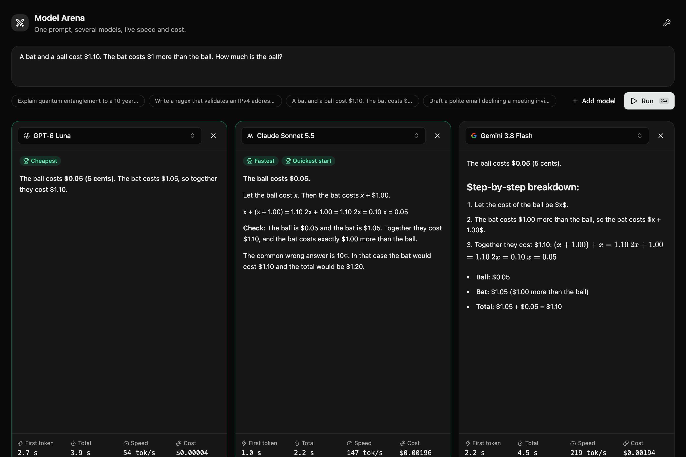

# Model Arena Template

Send one prompt to up to four models at once and compare the answers side by side, with live time to first token, total time, tokens per second and the exact cost of every response. One LLM Gateway key covers every provider.



[](https://meetploy.com/new/clone?repository-url=https%3A%2F%2Fgithub.com%2Ftheopenco%2Fllmgateway-templates&repository-name=llm-model-arena&project-name=llm-model-arena&ploy-config=templates%2Fmodel-arena%2Fploy.yaml&env=LLMGATEWAY_API_KEY&envDescription=Enter%20the%20LLM%20Gateway%20API%20key%20required%20by%20this%20template.&envLink=https%3A%2F%2Fdocs.llmgateway.io%2Flearn%2Fapi-keys)

## Features

- Two to four lanes streaming in parallel, each with its own model picker
- Per-response metrics: first token, total time, output tokens per second and cost in USD
- Badges for the fastest, quickest to start and cheapest model once every lane finishes
- Markdown, code highlighting and math rendered while streaming ([Streamdown](https://streamdown.ai))
- Searchable model picker ([AI Elements model selector](https://elements.ai-sdk.dev/components/model-selector)) filled live from the LLM Gateway catalog
- Bring-your-own-key dialog, or a server-side key from the environment

## Tech Stack

- **Framework**: Next.js 16 (App Router)
- **UI**: React 19, Tailwind CSS 4, shadcn/ui, Streamdown
- **AI**: AI SDK 7 (`streamText`, `toUIMessageStream` message metadata, `useChat`), LLM Gateway Provider
- **Icons**: Lucide React

## Getting Started

### Prerequisites

- Node.js 22+ (24 LTS recommended)
- pnpm
- [LLM Gateway API Key](https://llmgateway.io)

### Installation

```bash
# Scaffold it with the CLI
npx @llmgateway/cli init --template model-arena

# Or from the root of this monorepo
pnpm install
cd templates/model-arena
```

### Environment Setup

```bash
cp .env.example .env.local
```

Edit `.env.local` and add your API key:

```env
LLMGATEWAY_API_KEY=your_api_key_here
```

Without a server key, the app asks each visitor for their own key and keeps it in the browser.

### Development

```bash
pnpm dev
```

Open [http://localhost:3000](http://localhost:3000) in your browser.

### Production Build

```bash
pnpm build
pnpm start
```

## How it works

Each lane is its own `useChat` instance that posts to `/api/arena` with its model id. The route streams the answer with `streamText` and attaches metrics to the final message as [message metadata](https://ai-sdk.dev/docs/ai-sdk-ui/message-metadata):

- `firstTokenMs` and `tokensPerSecond` come from the AI SDK step `performance` stats
- `costUsd` comes from `providerMetadata.llmgateway.usage.cost`, enabled with `{ usage: { include: true } }` on the model

## API Reference

### POST /api/arena

**Request Body:**

```json
{
  "model": "claude-sonnet-5-5",
  "messages": [
    {
      "id": "1",
      "role": "user",
      "parts": [{ "type": "text", "text": "Hello!" }]
    }
  ]
}
```

**Response:** UI message stream. The final `finish` chunk carries `messageMetadata`:

```json
{
  "model": "claude-sonnet-5-5",
  "firstTokenMs": 800,
  "totalMs": 1800,
  "inputTokens": 41,
  "outputTokens": 120,
  "tokensPerSecond": 177,
  "costUsd": 0.00194
}
```

## Model catalog

The picker is filled at request time from the gateway's public [`/v1/models`](https://api.llmgateway.io/v1/models) catalog (`src/lib/models.ts`, revalidated hourly), so models added to LLM Gateway show up without a code change. Model ids are sent unprefixed (`gpt-6-luna`) so the gateway [smart-routes](https://docs.llmgateway.io/features/routing) each request to the best available provider — prefix one with a provider id (`openai/gpt-6-luna`) to pin it instead.

## License

MIT

## Enterprise deployments

Set `LLMGATEWAY_GATEWAY_URL` to your inference gateway URL (without `/v1`) in `.env.local`. Keep API keys in server-side environment variables.
